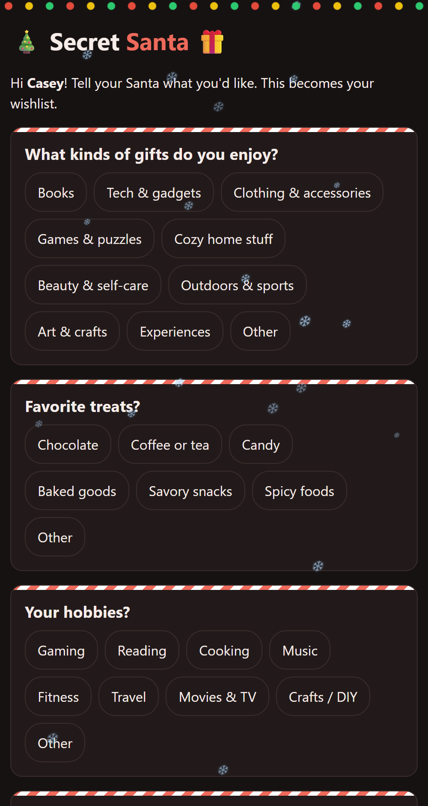
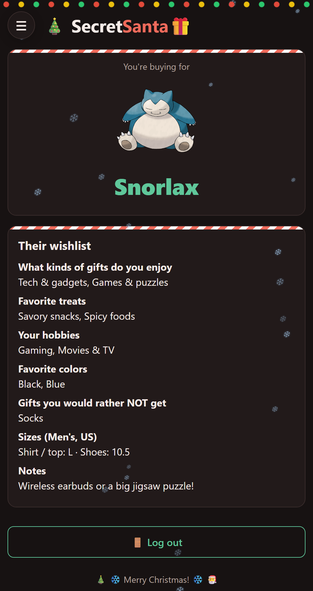
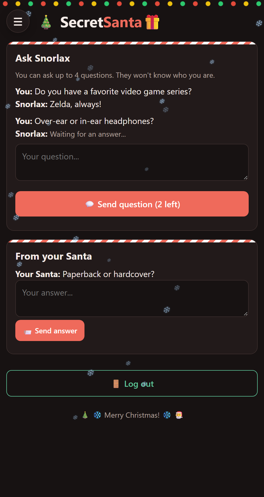
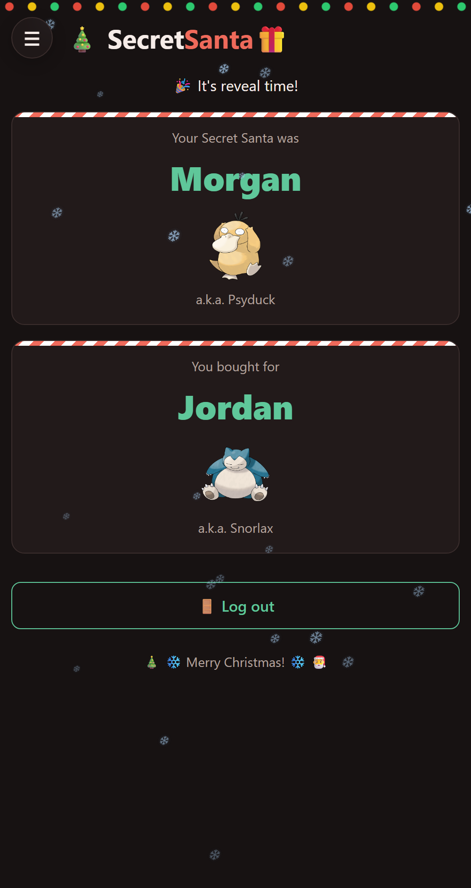

# 🎄 Secret Santa

A small Secret Santa website for a family or friend group. Everyone gets a private login code, fills out a gift questionnaire that becomes their wishlist, and receives a Pokémon code name. The organizer draws names, and each person sees only who they are buying for (by code name) plus that person's wishlist. On gift day the site reveals who everyone's Secret Santa was.

The whole site is one file, `index.html`. It uses [Firebase](https://firebase.google.com/) (Google's free app backend) to store everything, so there is no server for you to run.

This guide walks you through setting up your own copy from scratch. No coding experience is needed beyond copying and pasting.

<p align="center">
  
  
  
  
</p>

> 📖 **Prefer pictures?** The illustrated, step-by-step version of this guide, plus a live demo you can click through, is on this repository's GitHub Pages site (the `docs` folder). See [About the guide site](#about-the-guide-site).

---

## Contents

1. [Features](#features)
2. [What you need](#what-you-need)
3. [Step 1: Create a Firebase project](#step-1-create-a-firebase-project)
4. [Step 2: Connect the website to Firebase](#step-2-connect-the-website-to-firebase)
5. [Step 3: Turn on anonymous sign-in](#step-3-turn-on-anonymous-sign-in)
6. [Step 4: Create the database](#step-4-create-the-database)
7. [Step 5: Add the security rules](#step-5-add-the-security-rules)
8. [Step 6: Customize your event](#step-6-customize-your-event)
9. [Step 7: Put the website online](#step-7-put-the-website-online)
10. [Step 8: Run your Secret Santa](#step-8-run-your-secret-santa)
11. [Starting over next year](#starting-over-next-year)
12. [How the data is stored](#how-the-data-is-stored)
13. [Security notes](#security-notes)
14. [Troubleshooting](#troubleshooting)
15. [Cost](#cost)
16. [About the guide site](#about-the-guide-site)
17. [Credits](#credits)

---

## Features

**For everyone**
- Join by picking your name from a list; the site gives you a personal 6-character login code.
- Fill out a gift questionnaire (gift types, treats, hobbies, colors, things to avoid, clothing sizes, notes). This becomes your wishlist.
- Get a random Pokémon code name, with its picture, when you finish your wishlist.
- See who you are buying for (by code name only) and their wishlist.
- Ask your match up to 4 anonymous questions, and answer questions from your own Secret Santa.
- Tick "I've bought my gift". A countdown shows the days left until gifts are due.
- On the due date (or when the organizer chooses) see who your Secret Santa was.
- Works on phones, supports dark mode, and has falling snow. ❄️

**For the organizer**
- Create the event: name, budget, due date and participant list.
- See who has joined and who has finished their wishlist, without seeing anyone's code.
- Add or remove people, and reset a login if someone loses their code.
- Draw names so nobody gets themselves or their partner. You can add extra "can't match" pairs.
- See how many people (not who) have bought their gift.
- Reveal everyone's Secret Santa early, or hide the reveal again.

---

## What you need

- A **Google account**, for Firebase.
- A **text editor** to edit `index.html`. Notepad works; [VS Code](https://code.visualstudio.com/) is nicer.
- A place to host the site. Pick one:
  - **GitHub Pages:** needs a free [GitHub](https://github.com/) account. Everything is done in the browser.
  - **Firebase Hosting:** needs [Node.js](https://nodejs.org/) installed and a few terminal commands.

Start by downloading this repository: click the green **Code** button, then **Download ZIP**, and unzip it.

---

## Step 1: Create a Firebase project

1. Go to the [Firebase console](https://console.firebase.google.com/) and sign in with your Google account.
2. Click **Create a project** (or **Add project**).
3. Enter a name, for example `secret-santa`. Firebase adds a few random characters to make a unique **project ID**, such as `secret-santa-1a2b3`.
4. Google Analytics isn't needed. You can turn it off.
5. Click **Create project**, wait for it to finish, then click **Continue**.

You are now on the project's **Project Overview** page.

---

## Step 2: Connect the website to Firebase

1. On **Project Overview**, click the **Web** icon (it looks like `</>`) to add a web app.
2. Enter a nickname, such as `secret-santa-web`. **Don't** tick "Also set up Firebase Hosting"; that comes later if you want it.
3. Click **Register app**.
4. Firebase shows some code containing a block like this:

   ```js
   const firebaseConfig = {
     apiKey: "AIza...",
     authDomain: "secret-santa-1a2b3.firebaseapp.com",
     projectId: "secret-santa-1a2b3",
     storageBucket: "secret-santa-1a2b3.firebasestorage.app",
     messagingSenderId: "123456789012",
     appId: "1:123456789012:web:abc123..."
   };
   ```

5. Open `index.html` in your text editor and find this section near the top of the `<script>`:

   ```js
   // ===== PASTE YOUR FIREBASE CONFIG HERE (see README, step 2) =====
   const FIREBASE_CONFIG = {
     apiKey: "PASTE_YOUR_API_KEY",
     ...
   };
   ```

6. Replace each `PASTE_...` value with the matching value from Firebase. Keep the quotes and commas. Save the file.
7. Back in Firebase, click **Continue to console**.

> **Is it safe to put this in a public website?** Yes. Every Firebase web app sends this config to the browser; it identifies your project but isn't a password. Your data is protected by the security rules in Step 5, not by hiding the config. See [Security notes](#security-notes).

---

## Step 3: Turn on anonymous sign-in

The site signs each visitor in to Firebase anonymously (no email or password), and the database only answers people who are signed in.

1. In the left menu, open **Build → Authentication**.
2. Click **Get started**.
3. Open the **Sign-in method** tab.
4. Click **Anonymous**, switch it **on**, and click **Save**.

---

## Step 4: Create the database

1. In the left menu, open **Build → Firestore Database**.
2. Click **Create database**.
3. If asked for an edition, choose **Standard**.
4. Pick a **location** close to your group (for example `nam5 (United States)`). This can't be changed later.
5. Choose **Start in production mode** and click **Create**.

You don't need to create any collections. The site creates them the first time you open it.

---

## Step 5: Add the security rules

Security rules decide who may read and write your database. Production mode starts with everything blocked, so the site won't work until you do this step.

1. In **Firestore Database**, open the **Rules** tab.
2. Delete everything in the editor.
3. Open `firestore.rules` from this repository, copy all of it, and paste it into the editor.
4. Click **Publish**.

The rules only let signed-in visitors in, only allow the collections and fields the site uses, and limit each question thread to 4 messages. Read [Security notes](#security-notes) to understand what they do and don't protect.

---

## Step 6: Customize your event

Everything you can change lives in the `<script>` section near the top of `index.html`. After editing, save the file.

### Couples who shouldn't draw each other

```js
const COUPLES=[
  // ["Alex","Jordan"],
  // ["Sam","Taylor"],
];
```

Add one line per pair and remove the `//` in front. The names must match the names you type when you create the event (capitals don't matter). The organizer can also add extra pairs on the draw screen, so this is optional.

### Code names

```js
const DEX={"Pikachu":25,"Eevee":133,"Bulbasaur":1, ...};
```

Each person gets one of these Pokémon as their code name when they finish their wishlist. The number is the Pokémon's **National Pokédex number**, which the site uses to load its picture. You can look up numbers on [Bulbapedia](https://bulbapedia.bulbagarden.net/wiki/List_of_Pok%C3%A9mon_by_National_Pok%C3%A9dex_number).

Add **at least as many Pokémon as there are people**. If they run out, extra people get names like `Santa #13` with no picture.

### Optional "gift a pet or kid too?" popup

```js
const BONUS={
  enabled:false,
  title:"Biscuit & Pepper",
  text:"Biscuit and Pepper would love a little something under the tree this year. ...",
  pics:[["bonus1.jpg","🐶","Biscuit"],["bonus2.jpg","🐱","Pepper"]]
};
```

Turn this on (`enabled:true`) to show everyone a one-time popup asking whether they would also like to gift someone extra, such as your pets or a new baby. The organizer sees who said yes.

- `title` and `text` are what the popup says.
- Each entry in `pics` is `[image file, emoji, name]`. Put the image files next to `index.html`. If an image is missing, the emoji is shown instead.

### Questionnaire

The questions are in `const Q=[ ... ]`. Each one has an `id` (don't change it once people have answered), the question text `t`, and the answer choices `o`. Every question automatically gets an **Other** box.

---

## Step 7: Put the website online

Pick **one** of the two options.

### Option A: GitHub Pages (all in the browser)

1. Sign in to [GitHub](https://github.com/) and click **New repository**.
2. Give it a name, such as `secret-santa`. Set it to **Public**. GitHub Pages is only free for public repositories, which is fine because the config isn't a secret.
3. Click **Create repository**, then **uploading an existing file**.
4. Drag in your edited `index.html` (and any bonus images), then click **Commit changes**.
5. Go to the repository's **Settings → Pages**.
6. Under **Build and deployment**, set **Source** to **Deploy from a branch**, choose the **main** branch and the **/ (root)** folder, and click **Save**.
7. After a minute or two, the page shows your site's address, such as `https://your-username.github.io/secret-santa/`.
8. In Firebase, go to **Authentication → Settings → Authorized domains**, click **Add domain**, and add `your-username.github.io`.

### Option B: Firebase Hosting (command line)

Your site will be at `https://YOUR_PROJECT_ID.web.app`. This option also uploads the security rules for you.

1. Install [Node.js](https://nodejs.org/) (the LTS version).
2. Open a terminal **in the folder that contains `index.html`**.
3. Install the Firebase command-line tools:

   ```bash
   npm install -g firebase-tools
   ```

4. Sign in with the same Google account as your Firebase project:

   ```bash
   firebase login
   ```

5. Deploy, replacing `YOUR_PROJECT_ID` with your project ID from Step 1:

   ```bash
   firebase deploy --project YOUR_PROJECT_ID
   ```

6. When it finishes, it prints your **Hosting URL**. That's your site.

To publish changes later, edit `index.html` and run the deploy command again.

> **Windows tip:** if PowerShell says *"running scripts is disabled on this system"*, add `.cmd` to the commands: `npm.cmd install -g firebase-tools`, `firebase.cmd login`, `firebase.cmd deploy --project YOUR_PROJECT_ID`.

---

## Step 8: Run your Secret Santa

### Create the event (organizer, once)

1. Open your site. Because the database is empty, you'll see **Set up your Secret Santa**.
2. Fill in the event name, budget and gift due date.
3. Enter **your** name (you become the organizer) and everyone else's names, one per line.
4. Click **Create event & codes**.
5. The site shows **your personal code**. **Write it down.** It's the only way to log back in as the organizer.

> Open the site yourself first, before sharing the link. Whoever opens it first while the database is empty becomes the organizer.

### Invite everyone

1. Log in, open the **👑 Organizer** tab, and click **Copy site link**.
2. Send the link to your group.
3. Each person opens it, clicks **Pick my name**, chooses their name and gets their own code. Tell them to save it.
4. They fill out the questionnaire and get their Pokémon code name.

The Organizer tab shows who has joined and who has finished their wishlist.

### Draw names

1. Once everyone has joined (ideally after everyone has finished their wishlist), go to the **Organizer** tab.
2. Optionally add extra pairs who can't draw each other, one per line, like `Sam - Taylor`.
3. Click **Draw names**.

Everyone now sees **🎁 My Match** (their person's code name and wishlist) and **💬 Messages**. Drawing again replaces all matches and clears all messages.

### Help someone who lost their code

In the Organizer tab, click **Reset login** next to their name, then ask them to open the site, click **Pick my name** and choose their name again. Their wishlist and match stay the same. Do this only when they're ready to pick their name right away.

### Gift day

At midnight on the due date, a **🎉 Reveal** tab appears showing who everyone's Secret Santa was. The organizer can also reveal early (or hide it again) from the Organizer tab.

---

## Starting over next year

1. In the Firebase console, open **Firestore Database → Data**.
2. Delete the `event`, `people` and `chats` collections. Click the **⋮** menu next to each one and choose **Delete collection**.
3. Open your site. It shows the setup screen again.

People who visited last year may still have their old code saved in their browser; the site ignores it and shows the login screen.

---

## How the data is stored

| Collection | Document ID | What's in it |
|---|---|---|
| `event` | `main` | `title`, `budget`, `date`, `drawn`, `revealed` |
| `people` | the person's login code | `name`, `admin` (organizer), `claimed` (has picked their name), `done` (finished wishlist), `answers` (the wishlist), `codename`, `giveTo` (code of the person they buy for), `bought`, `kindness` (bonus popup answer) |
| `chats` | a person's login code | `items`: the questions asked to that person, each `{q, a}` |

---

## Security notes

This project is designed for a **small group of people who trust each other**, like a family. It keeps the surprise from people who play fair; it doesn't stop someone who is determined to snoop. Please read this before using it.

**What is protected**
- People who don't visit the site, or who visit without signing in, can't read or write anything.
- Only the collections and fields the site uses can be written, so the database can't be filled with unrelated data.
- Login codes are never shown to the organizer in the app.

**Known limitations**
- **Every visitor can technically read all the data.** The "Pick my name" screen loads the whole `people` collection. Anyone comfortable with the browser's developer tools can see every person's name, login code, wishlist and match.
- **Your match's ID is their login code.** `giveTo` stores the code of the person you are buying for, so a curious person could log in as their match.
- **Organizer checks happen in the browser only.** The `admin` flag decides which buttons appear, but the security rules don't check it, so a signed-in visitor could change data through the developer tools.
- **Anonymous sign-in** means "signed in" only proves someone opened the site, not who they are.

**Before you use it**
- Don't put anything sensitive in wishlists (addresses, phone numbers, passwords).
- Share the link only with your group.
- Delete the data after the event (see [Starting over next year](#starting-over-next-year)).

**How it could be made secure**
- Store names in a separate public list, and let each person read only their own `people` document using their code.
- Store matches under a random ID that isn't a login code.
- Use real sign-in (Google or email link) for organizers, and check organizer rights in the security rules.
- Draw names on a server (a Firebase Cloud Function) so that no one, not even the organizer, can see all the matches.

---

## Troubleshooting

| Problem | What to check |
|---|---|
| **"Almost there. Paste your Firebase config…"** | `FIREBASE_CONFIG` in `index.html` still has the `PASTE_...` values (Step 2). |
| **"Could not reach the database"** | The config values are correct and complete (Step 2), **Anonymous** sign-in is on (Step 3), the database exists (Step 4), and the rules are published (Step 5). Open the browser console (F12) for the exact error. |
| **Works on your computer but not on GitHub Pages** | Add `your-username.github.io` to **Authentication → Settings → Authorized domains** (Step 7A). Wait a minute after uploading for GitHub to update. |
| **"Could not save. Check your Firestore rules."** | The rules from `firestore.rules` were published in full (Step 5). |
| **"Couldn't find a valid draw with those rules."** | Too many "can't match" pairs for the group size. Remove some pairs, or add people. |
| **A couple was matched together** | The names in `COUPLES` must match the names entered on the setup screen. |
| **No Pokémon picture** | The Pokédex number in `DEX` is wrong, or the person got a `Santa #` name because the list ran out. |
| **Someone lost their code** | Organizer → **Reset login** (see [Step 8](#help-someone-who-lost-their-code)). |
| **You lost the organizer code** | In the Firebase console, open **Firestore Database → Data → people** and find the document whose `admin` field is `true`. Its document ID is your code. |

---

## Cost

Firebase's free **Spark** plan is enough for a group of family and friends; you don't need to add a credit card. GitHub Pages is free for public repositories.

---

## About the guide site

The `docs` folder is a separate website about this project. It isn't needed to run your Secret Santa.

| File | What it is |
|---|---|
| `docs/index.html` | The illustrated setup guide: a tour of every screen, the 8 setup steps with simplified pictures of the Firebase and GitHub pages, a progress tracker, an architecture diagram, security notes and troubleshooting. |
| `docs/demo/` | A working demo of the site. `fake-firebase.js` stands in for Firebase and keeps the data in the visitor's own browser, so no Firebase project is needed. The organizer code is `ALEX42`. |
| `docs/images/` | Screenshots of the demo, used in the guide and this README. |

To publish it, go to the repository's **Settings → Pages**, choose **Deploy from a branch**, branch **main**, folder **/docs**, and click **Save**. The guide appears at `https://your-username.github.io/your-repo-name/`.

`docs/demo/index.html` is a copy of `index.html` with an import map added at the top. If you change `index.html`, copy your change into the demo too.

---

## Credits

- Built with plain HTML, CSS and JavaScript, plus the [Firebase Web SDK](https://firebase.google.com/docs/web/setup) (Authentication and Cloud Firestore).
- Pokémon artwork is loaded from the [PokeAPI sprites](https://github.com/PokeAPI/sprites) repository. Pokémon and Pokémon names are trademarks of Nintendo, Creatures Inc. and GAME FREAK inc. This project isn't affiliated with or endorsed by them.
